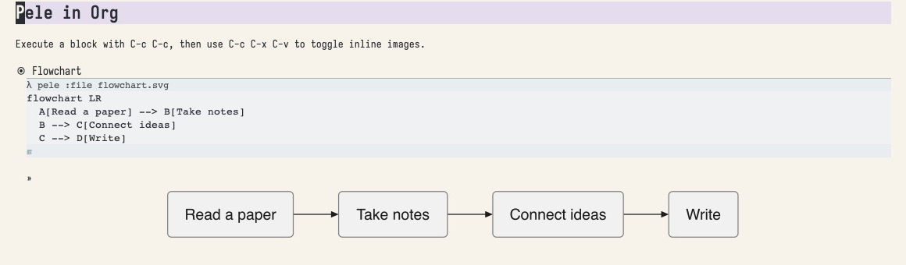
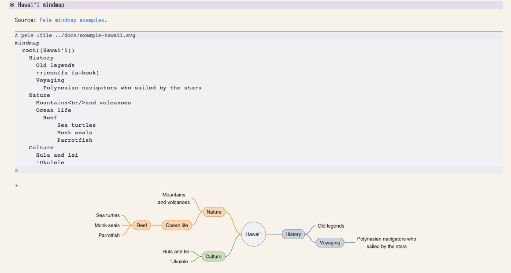
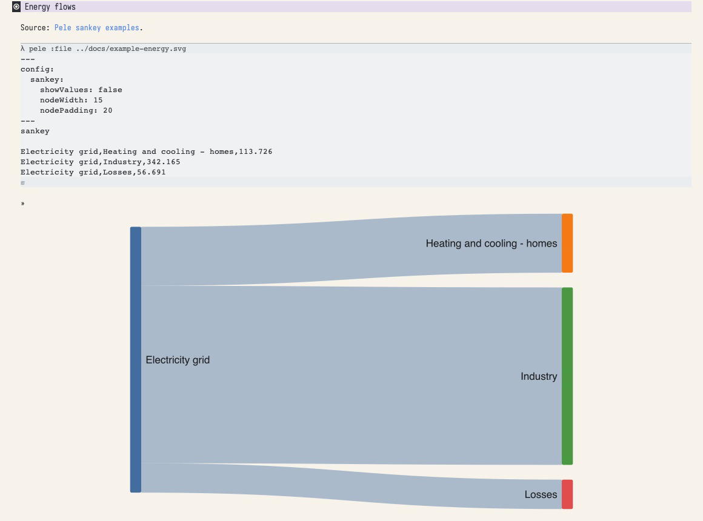
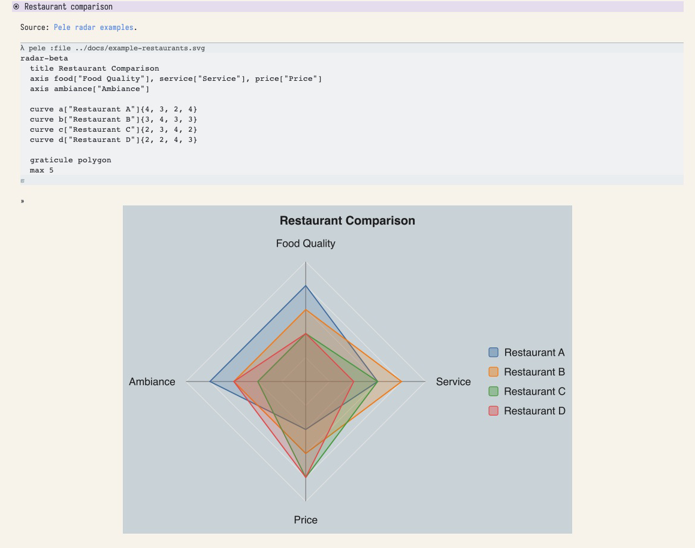
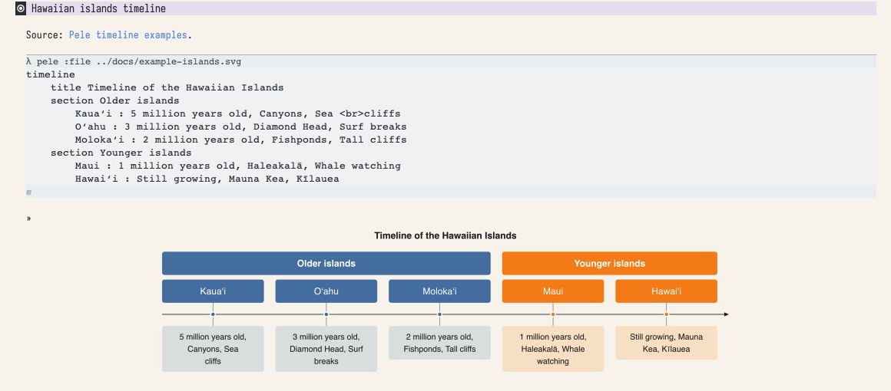

#+title: ob-pele

Render [[https://pele.run][Pele]] diagrams from Org Babel source blocks. Pele accepts Mermaid
syntax; this package runs it locally with Node.js and produces standalone SVG
files for inline display and HTML export.

An example source block and its inline SVG result in Emacs. Try it in
[[file:examples/diagrams.org][the example notebook]].

An early release; feedback and reproducible bug reports are welcome at
[[https://github.com/lgmoneda/ob-pele/issues][GitHub Issues]].

* Example gallery

Screenshots of Org buffers in Emacs, showing Pele source blocks and their
inline SVG results. The diagrams come from [[https://pele.run/examples][Pele's official examples]]. Open [[file:examples/colorful.org][the colorful example notebook]] for the source blocks
and executable examples. Upstream examples are MIT licensed; see
[[file:docs/pele-examples-LICENSE.txt][the Pele license]].

Hawaiʻi: a branching mindmap.

Energy flows: a Sankey diagram.

Restaurant comparison: a radar chart.

Hawaiian islands: a timeline.

* Requirements
- Emacs 27.1 or later with Org 9.4 or later.
- Node.js 20 or later and npm.
- SVG support in Emacs for inline previews.

* Installation
Clone the repository and install the renderer dependencies:

#+begin_src sh
git clone https://github.com/lgmoneda/ob-pele.git ~/repos/ob-pele
cd ~/repos/ob-pele
npm ci --registry=https://registry.npmjs.org --ignore-scripts
#+end_src

Add to your Emacs configuration (adjust the path):

#+begin_src emacs-lisp
(add-to-list 'load-path (expand-file-name "~/repos/ob-pele"))
(require 'ob-pele)
(add-to-list 'org-babel-load-languages '(pele . t))
#+end_src

Emacs must be able to find Node. If necessary:

#+begin_src emacs-lisp
(setq ob-pele-node-command "/opt/homebrew/bin/node")
#+end_src

The JavaScript dependencies live beside =renderer.mjs=. Keep that file,
=node_modules=, and =ob-pele.el= together when installing manually.
The package never installs dependencies automatically.

* Usage
#+begin_src org
,#+begin_src pele :file diagram.svg :results file graphics
flowchart LR
  A[Idea] --> B[Draft] --> C[Published]
,#+end_src
#+end_src

Press =C-c C-c= inside the block, then =C-c C-x C-v= to show inline images.
Try [[file:examples/diagrams.org][the example notebook]] for flowcharts, sequences, and mindmaps.
The output directory must already exist. Quote paths containing spaces.
Org's normal execution confirmation remains enabled.

| Header         | Meaning                                    |
|----------------+--------------------------------------------|
| =:file=        | Required SVG output path                   |
| =:font-size=   | Positive number, pixels (Pele default: 16)  |
| =:font-family= | Font name, e.g. "Helvetica"                 |
| =:max-width=   | Positive width constraint in pixels        |
| =:padding=     | Nonnegative padding in pixels              |

Defaults are =:results file graphics :exports results=. Org's =:dir=,
=:cache= and =:noweb= handling remains available. This backend does not create
output directories; create them before executing a block. Sessions and
=:var= are unsupported; use noweb to assemble diagram source.

* Rendering and limitations
The renderer fixes SVG dimensions and resolves Pele CSS variables to concrete
values, including locally scoped variables, for compatibility with Emacs SVG
viewers. It preserves the requested direction. There is no browser or network
request required for rendering ordinary text diagrams after installation.
External image references can still require network access in the viewer.

This first version supports local SVG output only. PNG/PDF conversion,
interactive browser behavior, and TRAMP execution are not implemented.
Pele estimates text widths outside a browser; installed fonts can affect the
appearance. Mermaid compatibility is determined by [[https://pele.run/compatibility][Pele]], not this backend.
SVG results work in HTML export; LaTeX/PDF workflows need a separate conversion.

On a renderer error, execution fails and any existing output file is retained.
Dependencies are pinned in =package-lock.json=.

* Development
#+begin_src sh
npm test
emacs --batch -Q -L . -l test/ob-pele-test.el -f ert-run-tests-batch-and-exit
emacs --batch -Q -L . -f batch-byte-compile ob-pele.el
#+end_src

The tests exercise multiple diagram types, standalone SVG attributes, Unicode,
Org result insertion, paths with spaces, header validation, and error handling.

* Maintainer
Luis Moneda ([[https://github.com/lgmoneda][@lgmoneda]]).

* License
MIT; see [[file:LICENSE][LICENSE]]. Pele and xmldom retain their own licenses.
